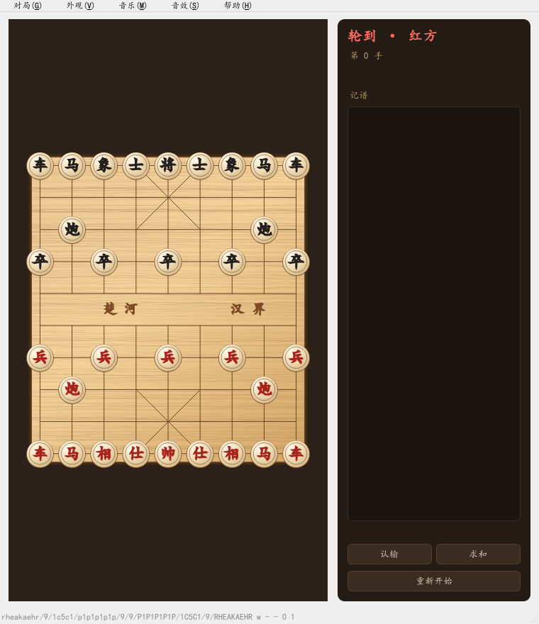
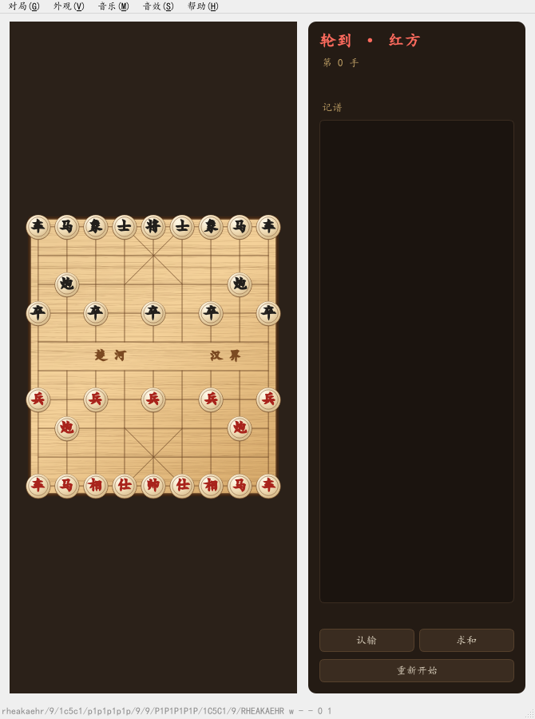
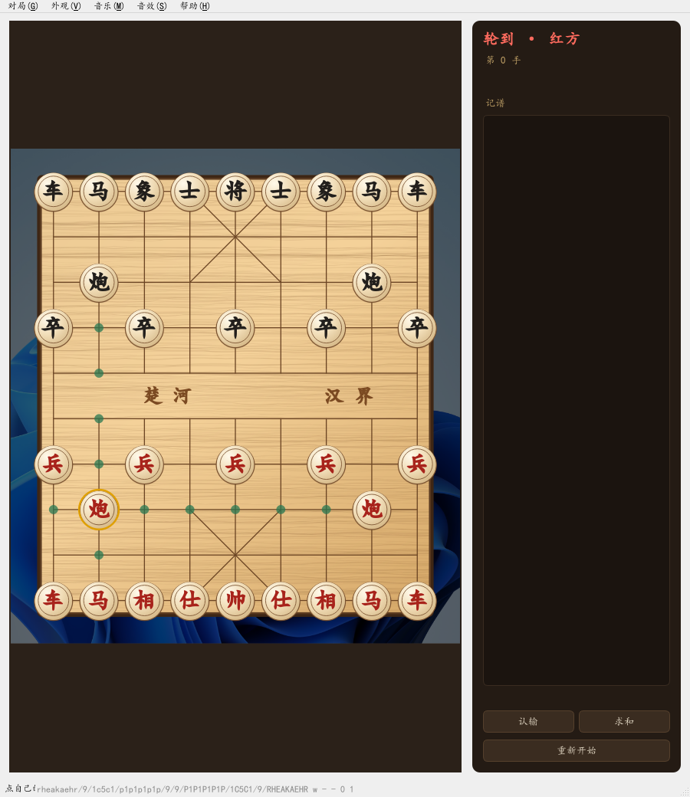
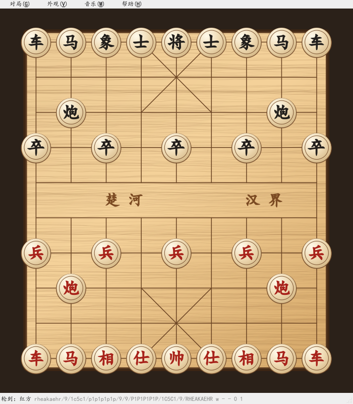

# M0 技术验证报告

日期：2026-10（本次会话） ｜ 结论：**5 项全部通过**，M0 可以关账，具备进入 M1 的条件。

---

## 一、总览

| # | 验证项 | 结果 | 关键数字 |
|---|---|---|---|
| ① | 主窗口 + QGraphicsView 棋盘，缩放不变形 | ✅ PASS | 三种窗口尺寸下缩放系数完全相等，棋盘宽高比恒为 0.8889（= 8/9） |
| ② | BGM 播放 + 音量淡入淡出 | ✅ PASS | 进入 PlayingState，进度推进 3 808 ms，淡入 0.048→0.8 单调上升，淡出 0.8→0.0 单调下降 |
| ③ | 背景图 + 暗化蒙版下棋盘可读 | ✅ PASS | 4K 壁纸铺底、暗化 55%，棋盘保持不透明木质，棋子对比度正常 |
| ④ | 两个客户端经 QWebSocket 互发一步棋 | ✅ PASS | 6 位房间码、seq 1→2 递增、发送方收到权威回执、第三人被拒"房间已满"、ping/pong 正常 |
| ⑤ | PyInstaller 打出 exe 并能启动 | ✅ PASS | 135.7 MB / 220 文件，冷启动到出帧 **0.56 s**，冻结后渲染正常 |
| — | pytest 单测 | ✅ 25 passed | 棋盘 + 走法 + 服务端协议 |

环境：Windows / Python 3.11.9 / PySide6 6.11.0（Qt 6）/ Qt 多媒体后端 FFmpeg 7.1.3 / aiohttp 3.14.5 / pytest 9.2.0。

---

## 二、逐项结果

### ① 棋盘渲染与缩放不变形

`BoardView` 用固定逻辑坐标（1 格 = 100 单位，场景 988 × 1088），窗口变化时只调
`fitInView(..., KeepAspectRatio)`。实测：

| 窗口 | 缩放 m11 | 缩放 m22 | 棋盘像素 | 格子像素 | 宽高比 | 场景是否完整入框 |
|---|---|---|---|---|---|---|
| 760×880 | 0.7652 | 0.7652 | 613×690 | 76.6 | 0.8884 | 是 |
| 1280×1500 | 1.2915 | 1.2915 | 1035×1164 | 129.4 | 0.8892 | 是 |
| 520×900 | 0.5223 | 0.5223 | 419×471 | 52.4 | 0.8896 | 是 |

m11 与 m22 完全相等 = 没有非等比拉伸；宽高比误差 < 0.001 = 格子始终是正方形。





**素材来源**：棋子与棋盘全部由 `client/artwork.py` 用 QPainter 生成——木纹是"渐变底 + 固定种子的细纹曲线"，
棋子是"径向渐变弧面 + 底部投影 + 内描边"，字体优先楷体、缺则回退微软雅黑。**没有任何外部图片**。

### ② BGM 播放与音量淡入

用现场合成的 440 Hz / 523 Hz 测试音（不引入任何音乐文件），34 次采样：

```json
{
  "played_state_reached": true,
  "position_advanced_ms": 3808,
  "fade_in":  { "start": 0.048, "peak": 0.8, "monotonic_rise": true },
  "fade_out": { "start": 0.8, "end": 0.0, "monotonic_fall": true }
}
```

Qt 6 在 Windows 上走 FFmpeg 后端（版本 7.1.3），mp3/ogg/wav 都能解。
音量淡入 Qt 没有现成组件，`client/media.py` 用 QTimer 分步逼近实现，可测、可打断。

### ③ 背景图 + 暗化

用系统自带壁纸（3840×2400）当背景，暗化 55%：


设计取舍：**背景图铺在棋盘外围，棋盘本身保持不透明木质**。如果让背景透过棋盘，
用户换一张花哨的图，棋子立刻看不清——这个坑提前避掉。设置里留了"背景更暗/更亮"各 ±10% 的调节。

选中棋子 + 落点提示（截图为红炮 b2 的真实伪合法着法）：



### ④ 双客户端联机

本进程另起线程跑 aiohttp，两个客户端用 `QWebSocket`（正式客户端就是它）：

```json
{
  "room_code": "467991",
  "A_move_to_B":  {"from": [1, 7], "to": [4, 7], "seq": 1},
  "A_own_echo":   {"from": [1, 7], "to": [4, 7], "seq": 1},
  "B_move_to_A":  {"from": [7, 0], "to": [4, 0], "seq": 2},
  "seq_increases": true,
  "sender_gets_echo": true,
  "third_client_rejected": "房间已满",
  "pong": {"t": 12345}
}
```

顺手定了两条协议约定（写进 M2）：

1. **发送方也会收到自己的权威回执**——客户端靠它对齐 `seq`，不吃"本地已走、服务端没收到"的亏。
2. **房间满员/房间不存在/未进房**都必须有明确 error 文案，M2 直接用。

### ⑤ 打包

```
dist\一起来下棋\
├─ 一起来下棋.exe
└─ _internal\            (135.7 MB、220 个文件，含 Qt 运行库与插件)
```

- 用 `--onedir`（不是 `--onefile`）：启动快，且后续做 NSIS 安装包更顺手
- 排除了 QtWebEngine / QtQuick / Qt3D / QtCharts / numpy 等用不到的模块
- 平台插件齐全：`qwindows.dll`、`qoffscreen.dll`、`qminimal.dll`、`qdirect2d.dll`
- 多媒体插件齐全：`ffmpegmediaplugin.dll`、`windowsmediaplugin.dll`
- `一起来下棋.exe --selftest` → 离屏渲染一帧并退出，**冷启动到出帧 0.56 s**

冻结后的实际渲染（由 exe 自己画出来的图）：



---

## 三、过程中发现并修掉的问题

| # | 现象 | 根因 | 处理 |
|---|---|---|---|
| 1 | 截图里棋子文字全是「□□□」 | 离屏渲染模式下 `QFontDatabase.families()` 为空，Qt 找不到系统字体目录 | `artwork.piece_family()` 检测到字体表为空时，手动 `addApplicationFont` 挂载 `simkai.ttf` / `msyh.ttc`；正常跑界面时不走这条路 |
| 2 | 棋盘底部被裁掉一截 | 首次 `fitInView` 用的是菜单栏/状态栏还没布局完的旧视口尺寸 | `BoardView` 增加 `showEvent` 里再 fit 一次，并把 `fit()` 提为公开方法 |
| 3 | 打包出的窗口版 exe 双击后卡住不动 | `console=False` 时 `sys.stdout` 为 None，`print()` 抛异常，PyInstaller 弹出错误对话框等用户点确定 | 诊断信息改为写 `selftest.log`，`_say()` 判空后再打印；重新打包后 0.56 s 正常退出 |
| 4 | 单测里 `seq` 断言失败（第二次走子仍读到 1） | 服务端把走子广播给**所有人，含发送方**，测试先读到了自己的回执 | 这是有意的协议设计；测试改为先消费自己的回执再读对手走子 |
| 5 | `pip install aiohttp` 卡了 10 分钟 | 直连 PyPI 在国内太慢，pip 退化成源码编译 | 换清华镜像 + `--only-binary=:all:`，20 秒装完 |
| 6 | **点击走子后画面不动，必须拖动窗口边框才刷新**（用户实测发现） | 重绘请求发给了 `QGraphicsView` 本身。它是 `QAbstractScrollArea`，自己 `update()` 只重画边框一圈；真正显示场景的是 `viewport()` | 统一改成 `_refresh()`：标记 item 脏 + `viewport().update()`；补了"重绘计数器"回归测试 `tests/test_view_repaint.py` |

> 第 6 条值得记一笔：**用 `widget.grab()` 截图是抓不到这个 bug 的**——grab 会强制直接渲染整个部件，
> 不管"有没有排上重绘队列"。所以之前所有截图看起来都正常，实际跑起来画面是死的。
> 这也是为什么这条补的是"数 paint 次数"的测试，而不是又一张截图。

---

## 四、与计划的偏差

| 项 | 计划 | 实际 | 说明 |
|---|---|---|---|
| 目录结构 | 包放在 `src\` 下 | 放仓库根目录 | `python -m`、pytest、PyInstaller 三处都少一层路径配置 |
| 启动速度 | 估 1–2 秒 | 0.56 秒（离屏自检到出帧） | 比预期好，真实带窗口会略慢 |
| 包体 | 目标 60–90 MB | 135.7 MB | 仍含较多 Qt 运行库，M4 再做一轮裁剪（`--exclude-module` 精细化 + 只留必需 dll） |
| 安装包 | M0 提到"确认能出安装包" | 只到 onedir | NSIS 放 M4，M0 证明"能打包运行"即可 |

---

## 五、已知限制（M1/M2 补）

- `moves.py` 只出**伪合法**着法：还没做"走完不能让自己被将军"、飞将、将死/困毙、重复局面、
  自然限着、长将/长捉——这些是 M1 的核心。
- 服务端目前只做消息中继，**不校验走法**；M2 换成用同一份 `xiangqi_core` 权威判棋。
- 没有房间界面、没有计时、没有断线重连——M2。
- BGM 播完自动切下一首的逻辑写了但未在本轮验证（测试音只有 6 秒，采样窗口 4 秒）。

---

## 六、复现命令

```powershell
.\.venv\Scripts\python.exe -m pytest
.\.venv\Scripts\python.exe tools\spike_board.py    # → docs\m0\shots\*.png、board-report.json
.\.venv\Scripts\python.exe tools\spike_audio.py
.\.venv\Scripts\python.exe tools\spike_net.py
.\.venv\Scripts\python.exe -m PyInstaller build\一起来下棋.spec --noconfirm --clean
dist\一起来下棋\一起来下棋.exe --selftest
```
