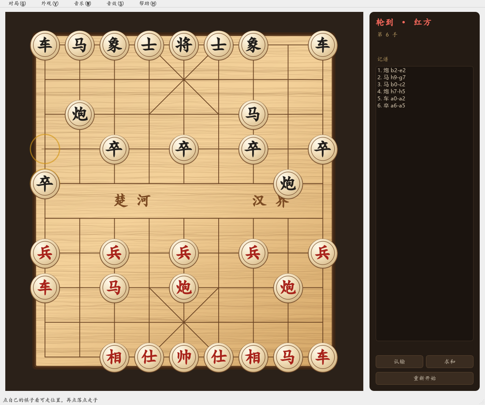
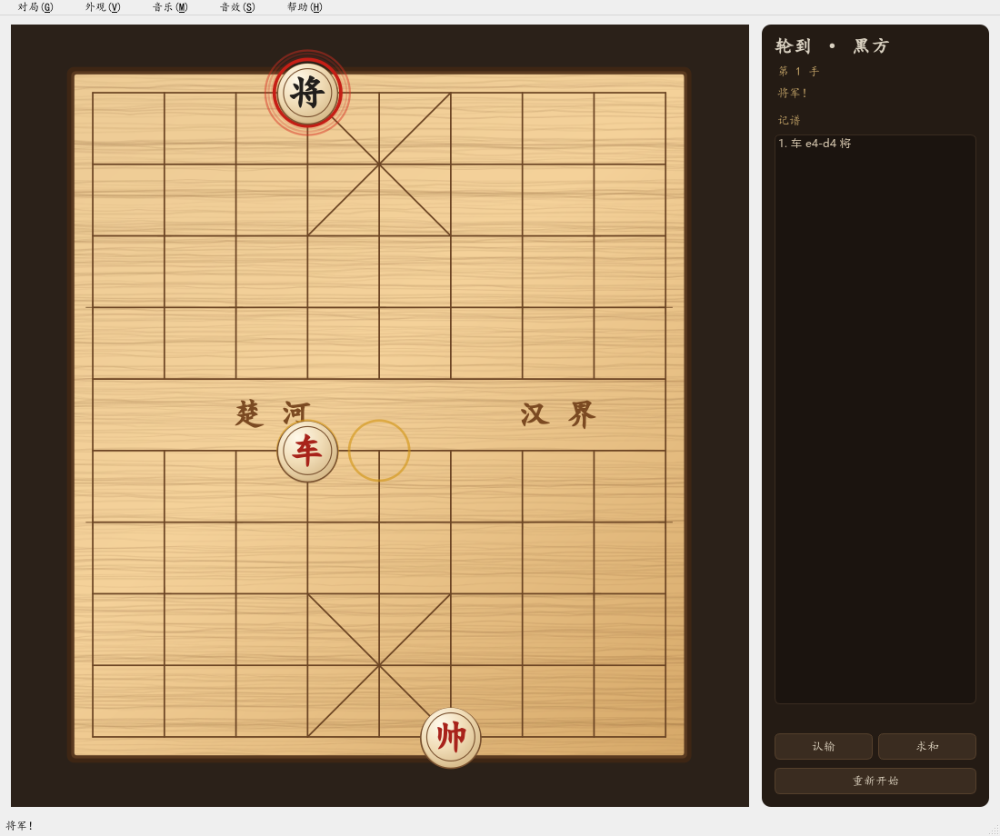
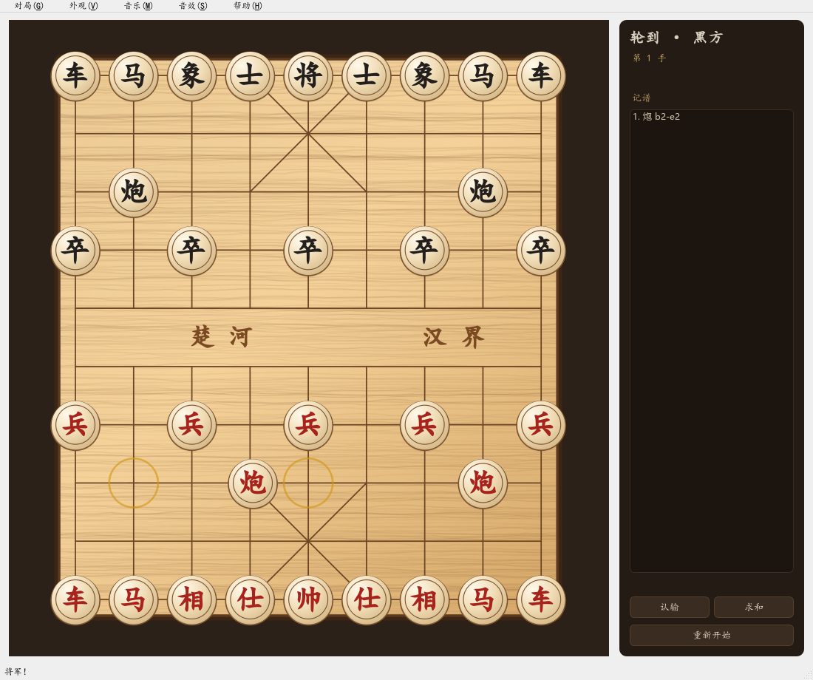
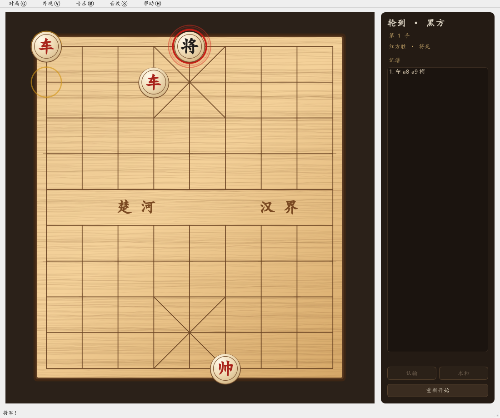

# M1 验证报告 · 本地双人可玩

日期：本次会话 ｜ 结论：**M1 验收标准全部达成**，可以进 M2（联机 + 读秒）。

---

## 一、验收对照

| 验收项 | 结果 | 证据 |
|---|---|---|
| 同一窗口红黑双方合法走完一局 | ✅ | `tools/m1_shots.py` 脚本化走完开局 6 手；界面截图见下 |
| 终局判定覆盖 | ✅ | 将死、困毙、三次重复、60 回合、长将判负、认输、求和各有用例 |
| 引擎单测 ≥80 | ✅ **85 passed** | 见下表分布 |
| 送将过滤 | ✅ | 牵制车/仕不能离线、帅不能走进入攻击格、被将军时必须应将 |

### 单测分布（85 个）

| 文件 | 数量 | 覆盖内容 |
|---|---|---|
| `test_board.py` | 8 | FEN 往返、坐标、走子/撤销、错误输入 |
| `test_moves.py` | 14 | 七类棋子走法、马腿、象眼、炮架、兵过河 |
| `test_rules.py` | 19 | 合法着法、飞将、被将军、牵制、将死/困毙基础 |
| `test_game.py` | 20 | 状态机、重复局面、长将、60 回合、悔棋、人工结局 |
| `test_engine_extra.py` | 16 | make/unmake、边界值、文案、威胁检测 |
| `test_server.py` | 3 | 服务端协议（M0 就有的） |
| `test_view_repaint.py` | 1 | 走子必须立刻重绘（防回归） |
| `test_ui_flow.py` | 4 | 走子→侧栏/记谱/锁定联动 |

---

## 二、引擎做了什么

### 1. 合法着法（`rules.py`）

在 M0 的伪合法着法上加了"走完不能让自己被将军"的过滤，并处理了中国象棋特有的两条：

- **飞将（将帅照面）**：两个老将同线且中间无子时，该方即算被将军 → 把挡着的子挪开是非法的。
  这一条必须并进"被将军"判定里，否则会出现"电脑允许你用挡将的子去送死"。
- **困毙判负**：无子可动但没被将军，在中国象棋里判**负**，不是和棋（国际象棋才是和棋）。

实现上给 `Board` 加了 `make()/unmake()`：走一步返回"现场快照"（被吃的子 + 走子方 + 两个计数器），
撤销时完整还原。合法性过滤就是"试着走一步 → 看自己是否被将军 → 回退"，全程零拷贝。

### 2. 对局状态机（`game.py`）

| 判定 | 规则 | 结果 |
|---|---|---|
| 将死 | 无合法着法且被将军 | 对方胜 |
| 困毙 | 无合法着法且未被将军 | **对方胜** |
| 三次重复 | 同一局面（含走子方）出现 3 次 | 长将方负，否则**判和** |
| 60 回合 | 120 个半回合无吃子 | 判和 |
| 长将 | 循环中某一方每一步都在将军 | 该方判负 |
| 长捉 | 循环中反复威胁同一批子 | **只提示不判罚**（按 D5） |

长将的判定逻辑：取"第三次出现该局面"之前的那一轮循环，看红黑各自在这一轮里的**全部**着法是否都将军；
只有一方如此 → 该方负；双方都如此 → 按和棋处理（罕见的双方长将）。

长捉提示则用另一条路：每个 `Entry` 记录"这步之后威胁到对手哪些子"，循环内对某一方取交集，
交集非空就说明它一直在盯着同一批子，给一条"建议协商"的提示——**不改变胜负**。

### 3. 界面（`client/`）

- **走子动画**：`QVariantAnimation` 驱动 170ms 补间，OutCubic 缓动。动画期间先不画落点，
  否则会看到"棋子先闪现到终点再滑回来"。
- **将军高亮**：被将的将/帅套三圈红环（外淡内实），侧栏同步显示"将军！"。
- **侧栏**：轮到谁、第几手、记谱列表、认输 / 求和 / 重新开始。
- **终局**：棋盘锁定、按钮禁用、弹窗提示结果（长捉提示一起显示）。
- **音效**：落子 / 吃子 / 将军 / 胜利四种，全部**程序合成**（正弦波 + 噪声包络写 WAV），
  零素材、零版权；音量与总开关在"音效"菜单。



左上角两个黄圈是"最后一步"的起点与终点；右侧记谱逐手可见（`将` 表示该步将军）。



黑将被红车将军：将被套红环，侧栏"将军！"，记谱该手带"将"字。



动画第 70ms（进度 0.61）：红炮正在从 b2 滑向 e2，落点方框已亮但棋子还没到位。



底线将死：红方胜、按钮禁用、棋盘锁定。

---

## 三、实现过程中踩到的坑

| # | 现象 | 根因 | 处理 |
|---|---|---|---|
| 1 | 测试里的"非法着法"居然是合法的 | 炮走到空点本来就合法，我把"炮不能吃自己的兵"想成了"炮不能越过己方子" | 改用真正非法的着法（炮落在己方马上），并给每条用例加注释说明为什么非法 |
| 2 | 飞将把"帅走到 (3,9)"也判成非法 | 测试局面里两个老将同在第 3 纵线，帅一走过去就是照面 | 在测试局面里加一个挡子，并把"照面"显式写进用例注释 |
| 3 | 困毙用例走不出结果 | 我摆的局面已经是困毙，却又让红方走了一步（轮次不对） | 改成"红方走出这一步才形成困毙"的局面 |
| 4 | 60 回合边界算错一步 | 半回合计数器每走一步就 +1，两个半回合就到 120 | 用例改成"118 → 走一步 119 → 再走一步 120 触线" |
| 5 | 音效一个都没生成 | `%APPDATA%` 在我的沙箱里不可写，`OSError` 被吞掉了 | 改成三级回退：环境变量 `YQLXQ_SFX_DIR` → 用户数据目录 → 系统临时目录；全失败则静音降级，不影响下棋 |

第 5 条顺带留了个后门：`YQLXQ_SFX_DIR` 既方便自动化测试，将来也能让用户把音效放到指定目录。

---

## 四、与计划的差异

| 项 | 计划 | 实际 | 说明 |
|---|---|---|---|
| 记谱 | 坐标记谱 | 坐标 + 吃子/将军标记（`车 e4-d4 将`、`马 h9-g7×炮`） | 多打两个字符，信息量大不少 |
| 悔棋 | v1.0 不做 | 引擎已实现 `Game.undo()`，界面未接入 | 留在 M2 与联机对局一起做（要和对手确认，不能单机悔） |
| 音效 | M1 只要求"落子音效" | 做了 4 种，且程序合成 | 合成代码比找素材快，且彻底规避版权 |
| 界面语言 | 简体中文 | 同 | 文案还没抽到 `strings.py`，M4 再集中 |

---

## 五、已知限制（M2 处理）

- 没有联机：服务端仍是 M0 的消息中继，**不校验走法**；M2 换成用同一份 `xiangqi_core` 判棋。
- 没有计时：读秒 30+30 的时钟与超时判负在 M2。
- 没有房间界面：建房/输码进房的 UI 在 M2。
- 没有断线重连。
- 长捉只提示，不做自动判罚（按决策，不是缺陷）。

---

## 六、复现

```powershell
.\.venv\Scripts\python.exe -m pytest            # 85 passed
.\.venv\Scripts\python.exe tools\m1_shots.py    # 生成 docs\m1\shots\*.png 与 report.json
.\.venv\Scripts\python.exe -m client.app        # 自己下一局
```
