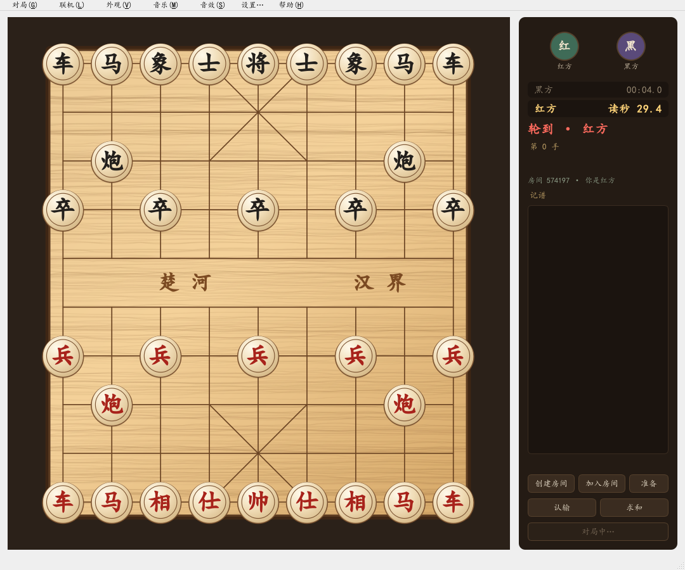
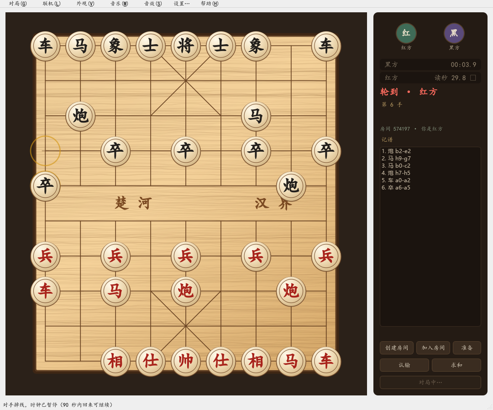
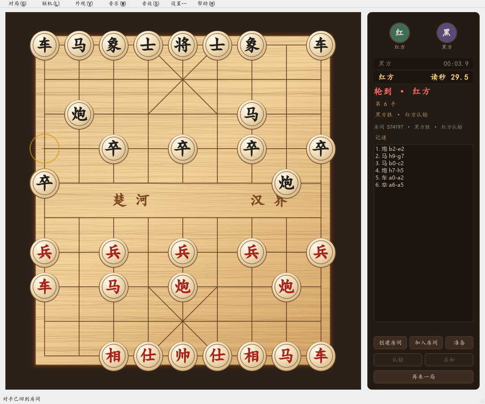

# M2 验证报告 · 联机闭环 + 读秒

日期：本次会话 ｜ 结论：**M2 验收标准全部达成**，可以进 M3（头像与素材）。

---

## 一、验收对照

| 验收项 | 结果 | 证据 |
|---|---|---|
| 两端下完一局 | ✅ | `tools/m2_e2e.py`：两个真实 Qt 客户端 + 服务端，建房→进房→就绪→6 手对局→认输结束，两端记谱完全一致 |
| 断线 20 秒恢复后局面一致 | ✅ | 同一脚本里主动拔掉一方连接，另一方立刻看到"时钟已暂停"，客户端自动重连后收到 `resync`（FEN + 记谱 + 时钟），记谱比对一致 |
| 读秒超时判负 | ✅ | `test_clock_timeout_ends_game`：4 秒保留用完后进入读秒，归零即 `game_over`，胜方正确 |
| 单元/集成测试 | ✅ **114 passed** | 见下表 |

### 测试分布（114 个）

| 文件 | 数量 | 覆盖 |
|---|---|---|
| `test_clock.py` | 7 | 保留时间、读秒切换、超时、暂停恢复、快照字段 |
| `test_session.py` | 18 | 房间、就绪、权威判棋、轮次、超时、掉线宽容、重连、认输、求和、再来一局换先 |
| `test_server.py` | 7 | 网络层：建房/进房/就绪/开局/走子广播/错误回包/重连 resync/超时 |
| 其余（M0/M1） | 82 | 棋盘、走法、规则、状态机、界面联动、重绘回归 |

---

## 二、架构：三层，职责不混

```
客户端 (PySide6)                       服务端 (aiohttp)
├ net.py        QWebSocket + 自动重连   ├ main.py     传输层：路由/广播/心跳/时钟推送
├ clock_bar.py  倒计时显示（本地插值）  ├ session.py  房间会话：权威判棋 + 断线 + 重来
├ app.py        界面与状态机            ├ clock.py    读秒时钟（monotonic）
└ board_view    只负责画                └ xiangqi_core  ← 与客户端同一份棋规
```

关键点：**服务端和客户端 import 的是同一份 `xiangqi_core`**。客户端改代码、改协议、
甚至自己写个外挂客户端，都改不了棋局结果——每一步都要过服务端的"轮次 + 合法 + 未超时"三重校验。

## 三、协议（v2）

| 方向 | 消息 | 说明 |
|---|---|---|
| C→S | `create_room{name}` | 回 `room_created{code, seat, token}` |
| C→S | `join_room{code,name}` | 回 `room_joined{code, seat, token, room}` |
| C→S | `reconnect{code,token}` | 回 `resync{seat, phase, room, game}` |
| C→S | `ready` / `move` / `resign` / `offer_draw` / `answer_draw` / `rematch` / `leave_room` | |
| S→C | `game_start{fen, redSeat, seats, clock, record}` | 开局；再来一局也走这条 |
| S→C | `move_applied{seq, seat, move, fen, record, clock, status}` | 含权威 FEN 与记谱，客户端可随时重建 |
| S→C | `clock{redMs, blackMs, turn, phase, paused}` | 每秒一次，客户端之间插值 |
| S→C | `game_over{winner, reason, text, status, clock}` | 将死/困毙/超时/掉线/认输/求和/循环判罚 |
| S→C | `opponent_offline{graceMs}` / `opponent_online` | 掉线与回归 |

## 四、读秒是怎么算的

- 每方 30 分钟保留（`base_left`），只在轮到自己时走表
- 保留时间耗尽后进入**读秒**：这一步剩下的时间从 30 秒里扣；之后每步重新给满 30 秒
- 超时判定：`remaining_ms() <= 0`，服务端 200ms 一次 tick，一到就判负
- **掉线不扣时**：一方断开 → 双方时钟一起 `pause()`，90 秒内回来 `resume()` 时把 `started_at` 往后挪，暂停期间一秒都不算
- 广播每秒一次，客户端在两次广播之间用本地单调时钟插值，所以数字是平滑跳动的

## 五、界面



红方 4 秒保留用尽，自动进入读秒（显示"读秒 29.3"），黑方保留时间不动。这是测试用短时钟，
正式运行时显示 `30:00` → `读秒 30.0`。



对方拔线后：时钟立刻停住并打上 ⏸，状态栏提示"90 秒内回来可继续"。这 90 秒里谁都不扣时。



认输后：结果写进侧栏、棋盘锁定、按钮禁用、"重新开始"变成"再来一局"（点了会换先手）。

## 六、踩坑记录（这次踩得比较狠，值得留档）

| # | 现象 | 根因 | 处理 |
|---|---|---|---|
| 1 | 红方玩家看到"你是观战" | `if color:` —— `Color.RED` 的值是 `0`，布尔判断为假 | 全部改成 `is not None`；顺带发现测试报表里同一个坑 |
| 2 | 重连后对面又显示"掉线"，时钟反复暂停 | 旧连接的 `finally` 清理把座位标成掉线，覆盖了新连接 | 清理时先比对 `seat.peer is peer`，不是当前连接就直接跳过 |
| 3 | 自动重连一直空转（日志刷"正在重连第 N 次"） | 复用同一个 `QWebSocket` 在"连上又立即断"时会卡在 ConnectingState，之后 `open()` 不再生效 | 每次重连都**新建 socket**，旧的 `abort()` + `deleteLater()` |
| 4 | 走子后剩余时间一次扣两次 | 先 `charge()` 再取快照，而快照又按"当前轮走方"重算了一遍已用时间 | 先 `switch_to(下一方)` 再取快照 |
| 5 | 终局时双方时间都显示 00:00 | `_finish()` 里先 `clock.finish()` 再取快照，停表后剩余时间退化为 0 | 先取快照再停表 |
| 6 | 联机认输后棋盘没锁 | 客户端只改了界面，本地 `Game.outcome` 还是"进行中" | `Game.set_outcome()` 由服务端结果驱动，界面再 `_sync_all()` |
| 7 | 暂停时读秒退化成 mm:ss | 显示逻辑里 `and not paused` 把读秒判断挡掉了 | 只要处于读秒阶段就显示"读秒 xx.x"，暂停只加 ⏸ |

第 1 条最典型：`Color.RED == 0` 在 Python 里是 falsy，凡是 `if color:` 都会静默走错分支。
现在代码里对 `Color`/`Status` 的判断统一用 `is None` / `is Status.X`。

## 七、已知限制（M3/M4）

- **头像**还没做：房间只显示昵称（M3）。
- 服务端是明文 `ws://`：自建自用够，公网长期跑建议套一层 TLS（M4 或上云时加）。
- 没有账号体系：房间码即身份，token 丢了就只能重新进房。
- 服务端进程重启会丢房间（状态在内存里），正式上线前可加轻量落盘。
- 观战、悔棋、聊天仍未做（按 v1.0 范围）。

## 八、复现

```powershell
# 单测（114 个）
.\.venv\Scripts\python.exe -m pytest

# 端到端：两个客户端 + 服务端，含拔线重连，产出 docs\m2\shots\*.png
.\.venv\Scripts\python.exe tools\m2_e2e.py

# 真机联机
.\.venv\Scripts\python.exe -m server.main --port 8765
.\.venv\Scripts\python.exe -m client.app     # 两台机器各开一个，联机菜单里填服务器地址
```
