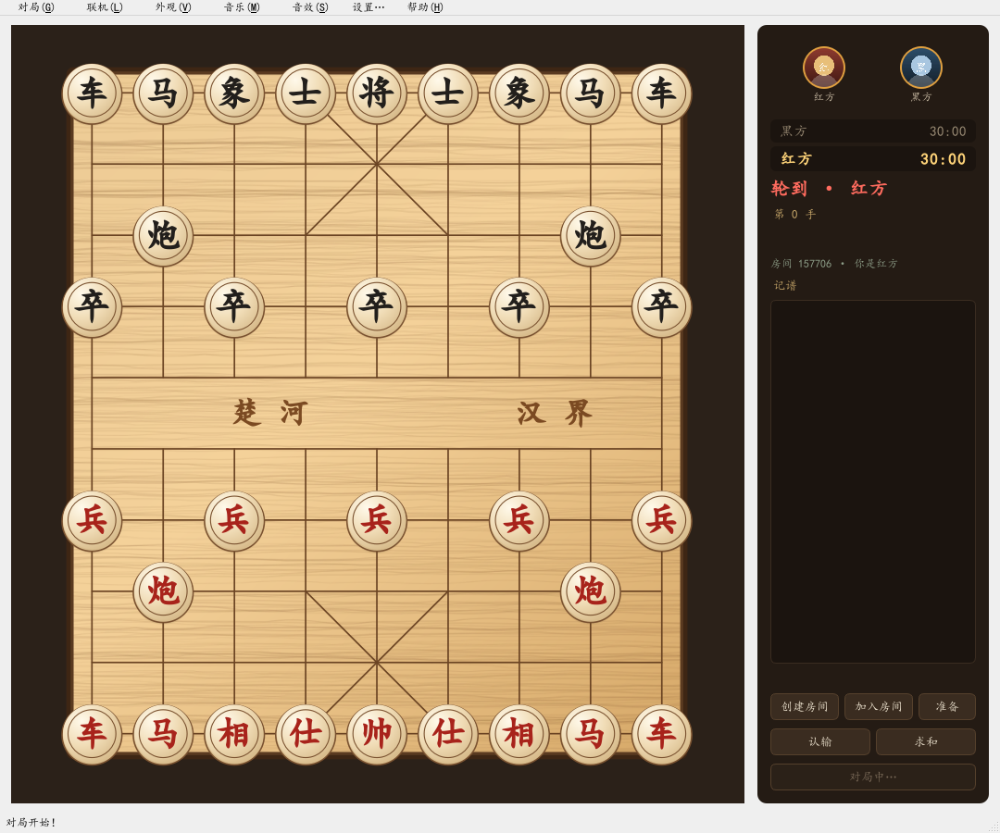
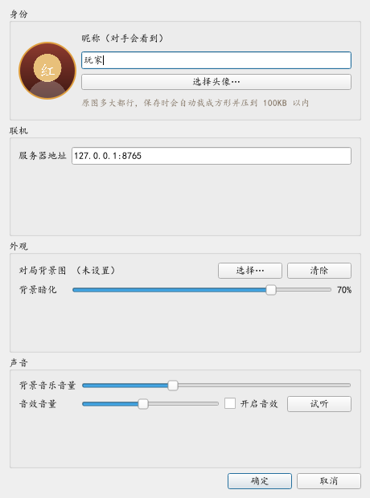
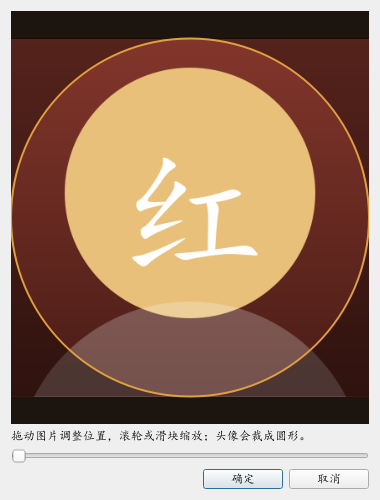

# M3 验证报告 · 头像、设置页与配置持久化

日期：本次会话 ｜ 结论：**M3 验收标准全部达成**。服务端打包仍按计划留在 M4。

---

## 一、验收对照

| 验收项 | 结果 | 证据 |
|---|---|---|
| 换头像后重启程序还在 | ✅ | e2e 末尾把头像写进配置并新建窗口：`avatar_loaded: true` |
| 对手能在房间里看到我的头像 | ✅ | 两个客户端互相 `opponent_badge.has_image: true`（走的是真实上传 → 落盘 → HTTP 拉取链路） |
| 背景图与 BGM 设置重启不丢 | ✅ | 同一份配置重载后 `darken=70`、`bgm_volume=0.33`、`sfx_enabled=false` |
| 测试 | ✅ **151 passed** | 新增 37 个：配置迁移/回退、头像校验、压缩、头像协议、界面联动 |

## 二、头像链路

```
选图 → 圆形裁剪(256×256) → 编码 WebP/PNG → WS 上传 → 服务端校验并落盘(哈希命名)
                                                          ↓
对手进房 → 拿到 avatar id → GET /avatar/{id} → 圆形角标显示
```

- **体积**：合成人像压出来 **8.9KB / 8.6KB**（WebP）
- **服务端校验**：只看文件头判断真实格式（PNG/JPEG/WebP），不信扩展名；超 256KB 直接拒
- **文件名是内容哈希**：同一张图不会重复存；读取时用正则卡 id，天然防路径穿越
- **返回头**：`X-Content-Type-Options: nosniff` + `Cache-Control: max-age=86400`



侧栏顶部：左边是我的头像（红框高亮表示轮到我），右边是对手的；没有头像时用昵称首字生成色块。

## 三、设置页



一个对话框把原来散在菜单里的东西收齐了：昵称、头像、服务器地址、背景图与暗化、音乐/音效音量、音效开关试听。
确定后立刻生效并写盘，不用重启。



裁剪框：拖动平移、滚轮或滑块缩放、圆形遮罩预览，"所见即所得"。

## 四、配置结构（v2）

```json
{
  "schemaVersion": 2,
  "nickname": "玩家",
  "server": {"host": "127.0.0.1", "port": 8765},
  "avatar": {"id": "9f2c…", "file": "…/avatars/me-9f2c….webp"},
  "look": {"background": "D:/图片/bg.jpg", "darken": 55},
  "audio": {"bgm_volume": 0.65, "sfx_volume": 0.7, "sfx_enabled": true},
  "window": {"width": 1120, "height": 920}
}
```

- **迁移**：M1/M2 时代的老配置是扁平的 `server_host` / `server_port`，读到会自动升级成 v2 结构（有测试）
- **容错**：文件损坏 / 缺字段 / 类型不对，一律退回默认值，绝不因为配置坏了打不开程序
- **原子写**：先写 `.tmp` 再 `os.replace`，写一半断电也不会把配置写坏

## 五、踩坑

| # | 现象 | 根因 | 处理 |
|---|---|---|---|
| 1 | pytest 整个进程直接崩掉（退出码 0xC0000409） | 先创建了 `QWidget` 再创建 `QApplication`，Qt 直接 abort，Python 层抓不到 | 测试模块顶部先建 QApplication；这条写进注释，避免以后再踩 |
| 2 | 对手头像一直不出现 | e2e 里直接 `connect_to(随机端口)`，而头像拉取用的是配置里的 `8765` | 头像地址改用**实际连上的** host:port，而不是配置值 |
| 3 | 建房时头像丢了 | 连接建立后要先上传头像、拿到 id 才能建房，脚本抢先建了房 | 上传完成回调里再执行"建房/进房"；脚本里也加了对应用例 |
| 4 | 联机对局中按钮显示"等待对手…"还能点 | 状态文案没区分"等待""对局中""已结束" | 改成三态：对局中按钮禁用 |

## 六、头像上传限制的修正（本轮返工）

先说结论：**"普通照片传不上去"跟 256KB 无关**，真正的凶手是服务端 WebSocket 的单帧上限。

| 项 | 修正前 | 修正后 |
|---|---|---|
| WS 单帧上限 | 64 KB | **4 MB** |
| 服务端头像上限 | 256 KB | **512 KB** |
| 客户端编码 | 固定 WebP q90，压不到就 PNG 硬传 | **自适应：先降质量（92→85→78→70），再降尺寸（256→224→192→160→128→96），保证 ≤96KB** |
| 界面上是否可见 | 看不到实际体积 | 选完头像显示"已压缩到 XXKB" |

复现方式（最坏情况：整张彩色噪点，照片都比它好压）：

```
噪声图 256×256 → WebP 62,030 字节 → base64 后 82,708 字节
旧单帧上限 65,536 字节 → 超限 → 连接被掐断（1009 message too big）
```

修完之后：同样这张图会被压到 96KB 以内再上传，单帧约 130KB，稳稳落在 4MB 之内。
另外加了三条回归用例：100KB / 500KB 的负载必须能传上去，600KB 必须被拒。

### 追加修复：保存失败被静默吞掉

用户实测反馈"选了图没反应"，用 `tools/check_avatar.py` 一跑就定位到了：

```
解码: 成功 631×774   裁剪: 成功 256×256   压缩: 成功 11.9 KB (webp)
落盘: 失败 —— [WinError 5] 拒绝访问: 'C:\Users\32286\AppData\Roaming\一起来下棋'
```

也就是说：**图本身完全没问题，卡在最后一步写配置目录**。而这一步抛的异常被 Qt 吞进了控制台，
界面上什么都不显示，看起来就像"点了没反应"。

修了四处：

| 问题 | 处理 |
|---|---|
| 配置目录不可写就整条流程挂掉 | `config_dir()` 现在会**真写一个探针文件**验证可写性，不行就按 `APPDATA → 家目录 → 临时目录` 逐级回退 |
| 异常被吞，用户看不到原因 | 设置头像全程 try/except，失败弹窗显示异常类型、消息和日志路径 |
| 存不下就等于白选 | 本地保存失败也先把图用上（本次会话有效），并在界面上注明"重启后需要重新选择" |
| 特殊格式读不出来 | 改用 `QImageReader`（能拿到具体错误）+ 应用 EXIF 旋转 + 统一转 ARGB32，CMYK / 16 位 / 索引色都能处理 |

另外加了两个排查入口：`帮助 → 打开配置目录`（里面就有 `avatar.log`），以及独立自查脚本：

```powershell
.venv\Scripts\python.exe tools\check_avatar.py "D:\图片\微信图片.jpg"
```

它会依次打印：读文件 → 解码 → 裁剪 → 压缩 → 落盘，哪一步挂了、报什么错，一目了然。

## 七、已知限制

- 服务端对头像只做**格式与大小校验**，不重新编码（重编码要引入 Qt/Pillow，服务端目前保持零 GUI 依赖）。
  客户端已经把图压到 256×256、≤96KB，实际风险很低；如果以后开放给陌生人，再补服务端重编码。
- 头像目前只在联机侧栏显示，棋盘上没有"执子方头像"之类的装饰（不需要）。
- 配置里的窗口大小会保存，但还没做"下次打开恢复上次位置"。

## 八、复现

```powershell
.\.venv\Scripts\python.exe -m pytest              # 147 passed
.\.venv\Scripts\python.exe tools\m3_e2e.py        # 头像互看 + 设置持久化，产出 docs\m3\shots
.\.venv\Scripts\python.exe -m client.app          # 菜单「设置…」（Ctrl+,）
```
